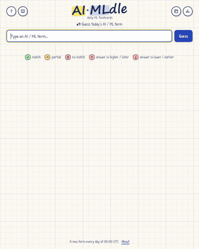

# AIMLdle

**▶ Play: [knissmootez.github.io/AIMLdle](https://knissmootez.github.io/AIMLdle/)**

**A daily guessing game for AI / machine learning terms.** Guess today's term, and every guess shows
how its attributes compare with the answer. When you solve it, you get a short explanation and the
source behind it, so every round teaches you something.

🟥🟧🟩⬆️  · 228 terms, from Leibniz's chain rule (1676) to DPO (2023) · new term every day at 00:00 UTC

<p align="center"></p>

## How to play

Type any AI / ML term (autocomplete helps). Each guess becomes a row of tiles:

| Tile | Meaning |
|---|---|
| 🟩 ✓ | same value as the answer |
| 🟧 ≈ | some values shared (multi-value attributes) |
| 🟥 ✗ | no match |
| ⬆️ ↑ / ⬇️ ↓ | the answer's year / difficulty is higher or lower |

Every tile also shows an icon, so the game works without relying on colour.

| Attribute | Example values |
|---|---|
| Category | Model, Component, Optimization, Technique, Metric, Statistical test, Concept, Dataset, Tool |
| Task | Classification, Regression, Clustering, Dimensionality reduction, Sequence modeling, Generation, Control, Recommendation, Evaluation, General |
| Learning | Supervised, Unsupervised, Self-supervised, Reinforcement, N/A |
| Year | year of the defining publication |
| Field | Statistics, Mathematics, Information theory, Physics, Computer science (academic discipline) |
| Family | Foundations, Classical ML, Deep learning, Transformer era (kind of method, not time period) |
| Difficulty | Beginner < Intermediate < Advanced |

The exact rules for every value are in [`data/ATTRIBUTES.md`](data/ATTRIBUTES.md).

Stuck? Every 3 guesses unlock a **hint** (up to 3) that reveals a trait of your choice, such as the
answer's Category or Year.

After the daily round you can share a spoiler-free result, check your streak, play **past days**
from the archive (calendar button; these don't affect your stats), or play unlimited practice rounds.

## How terms are sourced

- The core topics follow StatQuest's
  [Machine Learning playlist](https://youtube.com/playlist?list=PLblh5JKOoLUICTaGLRoHQDuF_7q2GfuJF),
  plus well-known terms from deep learning, generative AI, reinforcement learning and LLMs.
- Every term in [`data/terms.json`](data/terms.json) is hand-written and has a `source` (the paper or
  book behind its year and field). No AI calls at runtime.
- Terms whose year or field is debatable are flagged `"verify": true` until they're checked.
- `npm run validate` checks the schema, the allowed values, duplicate names or aliases, and that no
  two terms have identical attributes (which would make them impossible to tell apart).

Spotted a wrong fact? Please open an issue with a source.

## Development

Requires Node.js 22.18+ (the validator runs TypeScript directly).

```bash
npm install
npm run dev        # local dev server
npm test           # unit tests (Vitest)
npm run validate   # check data/terms.json
npm run build      # validate + typecheck + test, then build to dist/
npm run preview    # serve the production build
```

Plain TypeScript and CSS, with no UI framework and no runtime dependencies (about 20 KB gzipped).

| File | What it does |
|---|---|
| `src/compare.ts` | guess vs answer → tile states (the core game logic) |
| `src/daily.ts` | UTC date → puzzle number → term (seeded shuffle, no repeats until all terms are used) |
| `src/search.ts` | autocomplete matching (names and aliases, punctuation-insensitive) |
| `src/stats.ts` | streaks and guess distribution |
| `src/share.ts` | emoji share text |
| `src/storage.ts` | `localStorage`, wrapped so the game still works when storage is blocked |
| `src/main.ts` | DOM / UI |
| `scripts/validate.js` | data validation |

### Deploying

Every push to `main` is built and published to GitHub Pages by
[`.github/workflows/deploy.yml`](.github/workflows/deploy.yml). The build also validates the data and
runs the tests, so a broken build never goes live.

`npm run build` produces a static `dist/` folder with relative paths, so it also works on Vercel,
Netlify or any static host.

## Credits

Idea and testing: Mootez Kniss. Code written with Claude Code.
Topic list inspired by StatQuest with Josh Starmer (not affiliated).

## License

© 2026 Mootez Kniss. All rights reserved. See [LICENSE](LICENSE): you're welcome to play and read the
code, but please don't copy or re-host the game, its term dataset or its design.
